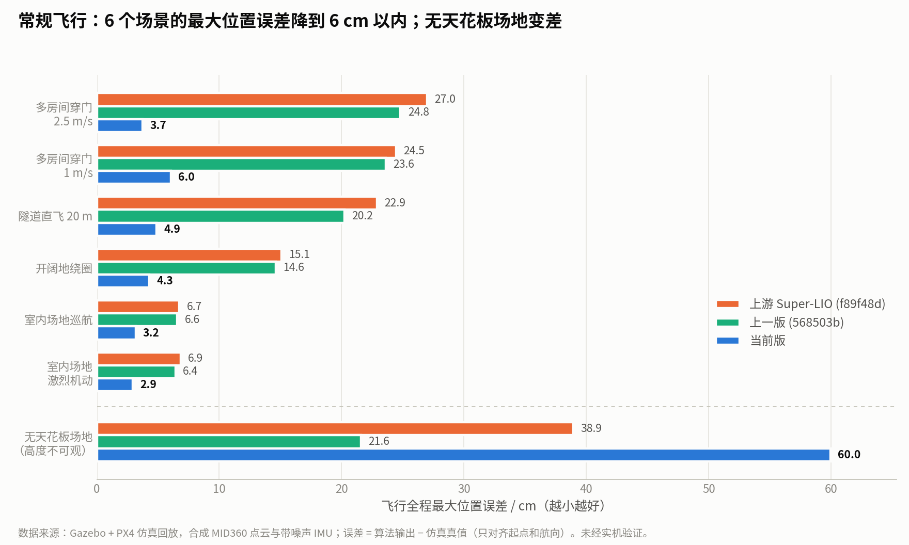
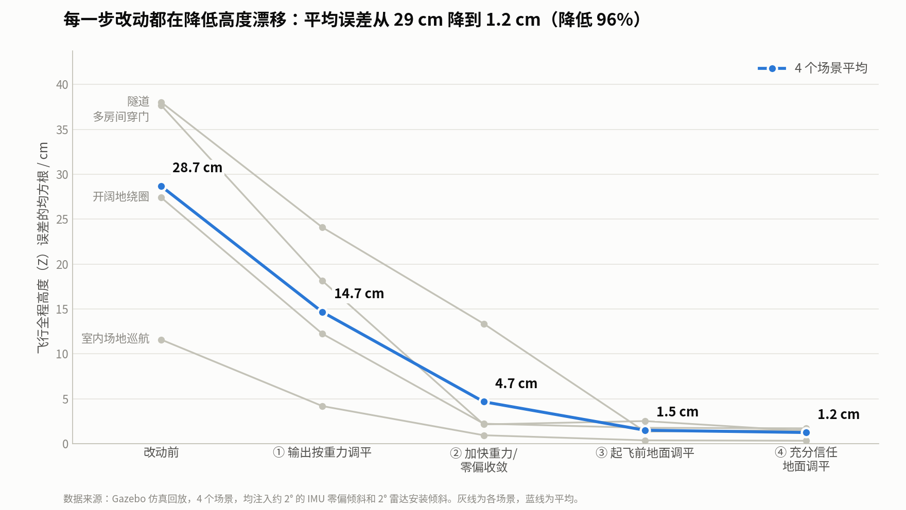
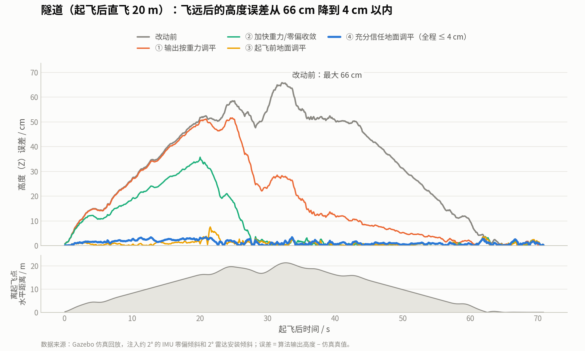

# Super-Lio

面向 Livox MID360 的 ROS 2 激光惯性里程计，用于无人机等算力有限的平台。基于上游 Super-LIO 的 `ros2` 分支，使用 MID360 点云和内置 IMU 估计位姿、输出去畸变点云。

在上游的基础上，本仓库主要做了三件事：

- **传感器数据异常时不发散。** 雷达断流、IMU 丢包、主机卡顿后能继续跟踪。
- **飞远以后高度不漂。** 消除加速度计零偏造成的世界系倾斜。
- **雷达可以倾斜安装。** 起飞前自动标定安装的俯仰和横滚，输出水平的机体位姿。


*系统框图来自上游 Super-LIO。本仓库沿用其 OctVoxMap、点云抽样和迭代滤波框架。*

## 效果

> 以下数据全部来自 Gazebo + PX4 仿真回放：合成 MID360 点云（含逐点时间和运动畸变）、带噪声和零偏的 IMU，真值取自仿真器。**尚未经过实机验证。**

### 常规飞行



六个常规场景的最大位置误差从 6.4~27 cm 降到 2.9~6.0 cm。无天花板的场地是例外，误差变大了，原因见[已知限制](#已知限制)。

### 高度漂移

世界系的竖直方向由开机静止时的加速度均值确定。加速度计有水平零偏时，世界系会歪一个小角度（30 mg 约 1.7°），高度误差随飞行距离线性增长。下图是在仿真里注入约 2° 的零偏倾斜和 2° 的安装倾斜后，逐项打开各改动的结果。





### 数据异常

数值为飞行全程的最大位置误差，单位 cm。✗ 表示发散。

| 场景 | 上游 `f89f48d` | 上一版 `568503b` | 当前版 |
| --- | ---: | ---: | ---: |
| IMU 中断 0.3 s + 0.8 s（多房间） | ✗ | ✗ | 7.2 |
| IMU 中断 0.08 / 0.25 / 0.7 s（激烈机动） | ✗ | ✗ | 4.7 |
| 主机卡顿 1.5 s + 3.0 s（激烈机动） | 65.3 | ✗ | 2.9 |
| 高噪声 IMU（激烈机动） | 17.9 | 17.8 | 3.3 |
| 隧道内遮挡 2~3 s | 18.2 | 21.6 | 4.9 |
| 隧道出口遮挡 2.5 s | 22.9 | 18.7 | 4.0 |
| 开阔地遮挡 2~3 s | 14.9 | 13.9 | 5.0 |
| 穿门时雷达断流 2.5 s | 28.1 | ✗ | 21.1 |
| 穿门时遮挡 2.5 s | 29.6 | 32.0 | 21.8 |
| 穿门时主机卡顿 2.0 s + 3.5 s | 28.0 | ✗ | ✗（不稳定） |
| 100 m 无特征走廊 | ✗ | ✗ | ✗ |
| 点云与 IMU 时间戳错配 | ✗ | ✗ | ✗ |

20 个标准场景中，上游通过 16 个，上一版 13 个，当前版 17 个。

### 倾斜安装

雷达前倾 20°、前倾 45°、横滚 15° 加俯仰 -25°、倒装 180°，在室内场地和隧道各飞一次，共 8 组：最大位置误差 2.7~6.3 cm，机体俯仰和横滚的平均误差 0.06~0.24°，最大不超过 0.8°。仿真只换算了坐标系，没有模拟倾斜后视野的变化。

### 算力

在桌面 CPU 上回放同一批数据，每帧处理耗时为上游 0.70 ms、上一版 0.62 ms、当前版 0.61 ms，内存约 59 MB。新增的地面拟合只在起飞前运行一次。未在 Jetson Orin NX 上实测。

## 改进内容

**时间对齐与配准**

- **以原始点包确定扫描结束时刻。** 使用点包中最大的逐点时间偏移，避免抽样、盲区过滤和距离过滤改变扫描的结束时间。
- **把 IMU 状态传播到扫描末端。** 用帧末两侧的 IMU 样本插值，将传播和去畸变对齐到同一时刻。融合位姿与世界系点云使用同一个时间戳。
- **降低大残差点对配准的影响。** 点到平面距离超过 0.05 m 后，观测权重随距离增大而降低（Huber），减轻墙角、柱边等处不可靠匹配对位姿的拉偏。
- **用去质心的主成分分析拟合平面。** 原来的代数形式在平面远离原点时有偏差，会在长走廊里形成虚假的约束。
- **拒绝跨面的平面拟合。** 近邻点到拟合平面的距离超过 0.03 m 时不使用该平面，避免把薄墙的两面混在一起拟合、使地图收缩。

**数据异常时的处理**

- **雷达断流或主机卡顿后继续跟踪。** IMU 历史保留 5 s，IMU 队列加深到 1200。恢复时从断流前的状态积分过来，不再把速度清零。
- **IMU 丢包时不清空缓冲。** 记录丢失的时间段，用两侧样本跨过去，按丢失时长放大协方差，雷达帧照常更新。
- **只在确实落后时丢弃过期的扫描。**
- **匹配点少时按比例降权。** 原来匹配比例低于阈值的帧被整帧拒绝，现在按内点数量缩小该帧的权重，内点少于 `min_inliers` 才视为无观测。

**高度漂移与安装姿态**

- **起飞前用地面确定竖直方向。** 初始化期间累积地平线以下的点，拟合地面，用地面法向代替加速度均值作为竖直方向，同时修正加速度计零偏的初值。找不到地面时自动跳过。
- **加快重力与零偏的收敛。** 放宽加速度计零偏的初始不确定度。没有找到地面时，起飞后经过几次转弯约 10 s 收敛。
- **按估计的重力方向调平输出。** 位姿和点云绕起飞点转平后发布，滤波器内部状态和地图不变。
- **自动标定安装的俯仰和横滚。** 起飞前假定机体水平，把雷达相对水平面的姿态作为安装姿态，从机体位姿中扣除。机头方向取雷达 x 轴的水平投影，所以偏航方向的安装角度不会被标定。

## 安装与编译

以下命令适用于 **Ubuntu 22.04 / ROS 2 Humble**。先按配套驱动仓库的说明编译并加载 `ws_livox`，使当前终端能够找到 `livox_ros_driver2` 消息包。[ws_livox 安装与构建](https://github.com/xhy-yyy/ws_livox/blob/main/README.md#安装与构建)

```bash
sudo apt install build-essential python3-colcon-common-extensions \
  libeigen3-dev libpcl-dev libgoogle-glog-dev libtbb-dev \
  ros-humble-pcl-ros ros-humble-pcl-conversions

source /opt/ros/humble/setup.bash
# 路径按 Livox 驱动工作区的位置调整
source ~/ws_livox/install/setup.bash

mkdir -p ~/ws_super/src
git clone git@github.com:xhy-yyy/Super-Lio.git ~/ws_super/src/Super-Lio
cd ~/ws_super
colcon build --executor sequential --packages-up-to super_lio
source install/setup.bash
```

在 Jetson Orin NX 上部署时，在目标设备上编译源码。

## 启动 MID360

在单独的终端启动 Livox 驱动。使用 `msg_MID360_launch.py`，配置 `xfer_format=1`，并根据实际网卡和雷达地址填写驱动的 `MID360_config.json`。

```bash
# Super-Lio 终端
source ~/ws_super/install/setup.bash
ros2 launch super_lio Livox_mid360.py rviz:=false
```

需要 RViz 时将 `rviz` 改为 `true`。仅回放或单独运行里程计时，可用下面的入口关闭额外的 MAVROS 视觉位姿发布。

```bash
source ~/ws_super/install/setup.bash
super_config="$(ros2 pkg prefix --share super_lio)/config/livox_360.yaml"
ros2 run super_lio super_lio_node --ros-args \
  --params-file "$super_config" -p lio.output.robot:=false
```

### 起飞前的要求

初始化在启动后的头几帧完成，这段时间决定了世界系和安装姿态，需要满足三点：

- **保持静止。** 用于估计重力方向和陀螺零偏。
- **机体水平停放。** 自动标定把此刻雷达相对水平面的姿态当作安装姿态。机体本身歪着放，歪的角度会被算进安装角。
- **周围 1~15 m 内能看到水平的地面。** 地面调平假定起飞点附近的地面是水平的。

初始化完成后查看日志确认结果：

| 日志 | 含义 |
| --- | --- |
| `ground plane found (N points), world tilt X deg corrected` | 找到地面，已按地面修正了 X° 的世界系倾斜 |
| `Ground plane not found, keeping accelerometer leveling` | 没找到地面，沿用加速度调平，起飞后靠转弯收敛 |
| `LiDAR mount tilt calibrated: X deg from level` | 标定出的安装倾角 |
| `LiDAR x axis is nearly vertical, heading cannot be derived from it reliably` | 雷达 x 轴接近竖直，无法可靠地确定机头方向 |

### 话题

| 方向 | 话题 | 用途 |
| --- | --- | --- |
| 输入 | `/livox/lidar` | `livox_ros_driver2/msg/CustomMsg`，包含逐点时间偏移 |
| 输入 | `/livox/imu` | `sensor_msgs/msg/Imu`，来自 MID360 内置 IMU |
| 输出 | `/lio/odom` | 世界系下的 IMU 位姿，按点云帧更新。是雷达自身的姿态，包含安装倾角 |
| 输出 | `/lio/imu/odom` | 世界系下的 IMU 前向传播位姿，按有效 IMU 样本更新 |
| 输出 | `/lio/robo/odom` | 机体位姿，已扣除自动标定的安装倾角，并经过 `lio.extrinsic.odom_robo` 转换 |
| 输出 | `/mavros/vision_pose/pose` | 发给飞控的机体位姿，`lio.output.robot` 为 `true` 时发布 |
| 输出 | `/lio/cloud_world` | 已去畸变、已变换到 `world` 坐标系的点云 |

开启输出调平后，以上位姿和点云都在调平后的世界系里，z 轴沿重力方向。

### 常用配置

在 [`livox_360.yaml`](src/super_lio/config/livox_360.yaml) 中调整参数。修改源码目录中的 YAML 后，重新构建以更新安装目录中的启动配置。

下表的默认值是 MID360 配置里的值。新增参数在代码里的默认值保持上游的行为，其他雷达的配置文件不受影响。

**话题与输出**

| 参数 | 默认值 | 用途 |
| --- | --- | --- |
| `lio.ros.lidar_topic` / `lio.ros.imu_topic` | `/livox/lidar` / `/livox/imu` | 驱动输出话题 |
| `lio.output.robot` | `true` | 向 `/mavros/vision_pose/pose` 额外发布机体位姿 |
| `lio.output.map` | `true` | 发布世界系点云 |
| `lio.output.level_by_gravity` | `true` | 按估计的重力方向调平输出的位姿和点云 |
| `lio.output.level_max_rate` | `1.0` | 输出调平的最大变化速率，单位 deg/s。越大矫正越快。范围 0.2~3.0 |

**初始化与安装姿态**

| 参数 | 默认值 | 用途 |
| --- | --- | --- |
| `lio.extrinsic.auto_mount_tilt` | `true` | 起飞前自动标定雷达安装的俯仰和横滚 |
| `lio.kf.init_level_by_ground` | `true` | 起飞前用地面确定竖直方向 |
| `lio.kf.ground_gravity_std` | `0.005` | 地面调平成功后重力方向的 1σ，单位 m/s²。越小越信任地面。范围 0.002~0.05，`0` 不收紧 |
| `lio.kf.init_acc_bias_std` | `0.1` | 加速度计零偏和重力方向的初始 1σ，单位 m/s²。越大起飞后收敛越快。范围 0.01~0.3 |

**配准**

| 参数 | 默认值 | 用途 |
| --- | --- | --- |
| `lio.kf.plane_huber_delta` | `0.05` | 点面残差开始降权的距离，单位 m。`0` 关闭 |
| `lio.kf.plane_fit_tol` | `0.03` | 近邻点到拟合平面的最大距离，单位 m。范围 0.02~0.1 |
| `lio.kf.min_match_ratio` | `0.10` | 内点比例低于该值的帧按比例降权。范围 0~0.5，`0` 关闭 |
| `lio.kf.min_inliers` | `20` | 内点少于该数视为无观测。范围 10~200 |
| `lio.kf.inlier_distance` | `0.15` | 计入内点的点面距离，单位 m。范围 0.05~0.3 |
| `lio.kf.max_imu_only_time` | `0.5` | 距上次雷达更新超过该时间后停止输出前向传播位姿，单位 s。范围 0.2~1.5，`0` 不限 |

## 已知限制

- **所有结果来自仿真。** 实机上的雷达噪声、振动和时间同步误差没有覆盖到。
- **没有天花板、周围又没有其他水平面时，高度不可观。** MID360 正装时向下只能看到 7°。在 10 m 见方、无顶的场地里，高度误差从上一版的 21.6 cm 增大到 60 cm：旧的平面拟合有偏差，在这个场景里恰好起到了约束作用，改正之后这个约束没有了。
- **穿门进入未建图的房间时，雷达断流或被遮挡 2.5 s 后会偏一个墙厚（约 20 cm）。** 地图没有记录面的朝向，恢复时墙的背面被匹配到了已存的正面。
- **穿门时主机卡顿 3.5 s 且同时丢失约 1.5 s 的 IMU 数据，可能发散。** 重复 5 次出现 1 次。
- **100 m 无特征的走廊会沿走廊方向漂移，点云与 IMU 时间戳错配时也会发散。** 这两项各版本都没有通过。
- **起飞前找不到地面，起飞后又一直直飞，高度漂移无法矫正。** 重力方向和加速度计零偏要靠转弯才能分开。
- **地面调平假定起飞点附近的地面水平。** 地面有坡度时，坡度会部分带进世界系，高度随飞行距离漂移。这种场地可以关闭 `lio.kf.init_level_by_ground`。

## 上游与许可证

本项目基于 Liansheng Wang 等人的 Super-LIO ROS 2 实现，基线提交为 `f89f48d`。算法和 OctVoxMap 的引用见原论文 *Super-LIO: A Robust and Efficient LiDAR-Inertial Odometry System with a Compact Mapping Strategy*，IEEE Robotics and Automation Letters, 2026。[上游源码](https://github.com/Liansheng-Wang/Super-LIO/tree/f89f48dc7aea6cfa262f18e4d03b319e04e0dbd2) · [论文](https://doi.org/10.1109/LRA.2026.3653372) · [GPL-3.0 许可证](LICENSE)
